# ЛР4. Клиентская часть на Vue.js

Разработка клиентской части веб-приложения с использованием Vue 3 и Vuetify для взаимодействия с REST API, реализованным в лабораторной работе №3. Предметная область — «Распределение газет по почтовым отделениям» (вариант 6).

## Описание компонентов

| Файл или компонент | Назначение |
|---|---|
| `main.js` | Создаёт и запускает Vue-приложение, подключает главный компонент `App.vue`, хранилище данных Pinia, маршрутизацию Vue Router, библиотеку компонентов Vuetify и необходимые стили. |
| `api.js` | Настраивает подключение к серверу Django с помощью Axios. Указывает адрес сервера, добавляет токен авторизации в заголовки запросов и содержит функцию для преобразования ошибок сервера в понятные сообщения. |
| `router/index.js` | Определяет адреса страниц приложения и компоненты, которые должны на них отображаться. Управляет переходами между разделами и проверяет наличие авторизации, ограничивая доступ к защищённым страницам. |
| `stores/auth.js` | Управляет авторизацией пользователя: хранит токен и данные текущего пользователя, выполняет вход, регистрацию и выход из приложения, а также получает информацию о пользователе с сервера. |
| `stores/data.js` | Загружает с сервера и хранит списки газет, типографий, почтовых отделений, тиражей и поставок. Позволяет использовать эти данные в разных разделах приложения, в том числе для отображения названий связанных записей вместо их идентификаторов. |
| `resources.js` | Содержит настройки пяти разделов приложения: газет, типографий, почтовых отделений, тиражей и поставок. Для каждого раздела определяет название, поля, их типы, подписи, связи с другими разделами и ограничения на редактирование. |
| `App.vue` | Формирует общую структуру интерфейса приложения: верхнюю панель, боковое меню с разделами и основную область для отображения страниц. Также показывает информацию об авторизованном пользователе и предоставляет возможность выхода из аккаунта. |
| `LoginView.vue` | Отображает форму входа с полями для имени пользователя и пароля. Передаёт введённые данные для авторизации на сервере, показывает сообщение при ошибке и после успешного входа переводит пользователя на главную страницу. |
| `RegisterView.vue` | Отображает форму регистрации с полями для имени пользователя, электронной почты, пароля и его повторного ввода. Проверяет совпадение паролей, отправляет данные для создания аккаунта и после успешной регистрации переводит пользователя на главную страницу. |
| `AccountView.vue` | Отображает данные учётной записи и позволяет изменять адрес электронной почты, имя пользователя и пароль. Отправляет изменения на сервер, показывает сообщения об успешном выполнении операций или возникших ошибках. |
| `ResourceView.vue` | Отображает записи выбранного раздела в таблице. Позволяет добавлять новые записи, изменять существующие и удалять их через диалоговые окна и кнопки управления. Для типографий дополнительно предусмотрена возможность закрытия с перераспределением тиражей. |
| `AnalyticsView.vue` | Отображает список аналитических запросов, связанных с газетами, типографиями, почтовыми отделениями и поставками. Позволяет выбирать необходимые параметры, отправлять запросы на сервер и просматривать полученные результаты в таблицах. |
| `ReportView.vue` | Получает с сервера и отображает отчёт о работе типографий. Для каждой типографии показывает её название, адрес, общее количество напечатанных экземпляров, тиражи отдельных газет и количество экземпляров, отправленных в почтовые отделения. |
| `components/JsonTable.vue` | Преобразует полученные от сервера данные в таблицу, автоматически определяя её столбцы. Используется для отображения результатов аналитических запросов, структура которых может различаться. |
  

## Схема взаимодействия с backend

В разработанном приложении фронтенд реализован с использованием Vue, а серверная часть — Django REST Framework. Для регистрации и авторизации пользователей применяется Djoser. Фронтенд отвечает за отображение интерфейса и обработку действий пользователя, а бэкенд выполняет запросы, обрабатывает данные и взаимодействует с базой данных PostgreSQL.

Фронтенд запускается по адресу `http://127.0.0.1:5173`, а сервер Django — по адресу `http://127.0.0.1:8000`. Обмен данными между ними осуществляется через HTTP-запросы с использованием библиотеки Axios. Данные в запросах и ответах передаются преимущественно в формате JSON.

### Последовательность взаимодействия

1. Пользователь выполняет действие в интерфейсе приложения, например открывает раздел с газетами, добавляет новую запись или запускает аналитический запрос. Соответствующий Vue-компонент обрабатывает действие и обращается к хранилищу Pinia либо непосредственно к функциям работы с сервером.

2. Через настроенный в файле `api.js` экземпляр Axios формируется и отправляется HTTP-запрос на сервер Django. Для получения данных используется метод GET, для создания записей — POST, для изменения — PUT или PATCH, а для удаления — DELETE.

3. Django получает запрос и передаёт его соответствующему обработчику. Django REST Framework отвечает за выполнение операций с газетами, типографиями, почтовыми отделениями, тиражами и поставками, а Djoser обрабатывает запросы, связанные с регистрацией и авторизацией пользователей.

4. При необходимости сервер обращается к базе данных PostgreSQL, запущенной в Docker. В зависимости от полученного запроса Django извлекает, добавляет, изменяет или удаляет записи. При выполнении аналитических запросов сервер обрабатывает данные из связанных таблиц.

5. После обработки запроса Django возвращает фронтенду HTTP-ответ. При успешном выполнении операции сервер может вернуть данные в формате JSON и соответствующий код состояния, например `200 OK` или `201 Created`. Если операция не предполагает возврата данных, может использоваться статус `204 No Content`. При возникновении ошибки сервер возвращает сообщение о её причине.

6. Фронтенд получает ответ сервера и обновляет интерфейс. Например, полученные записи отображаются в таблице, после добавления или удаления записи список обновляется, а результаты аналитических запросов выводятся в отдельной таблице. Если запрос завершился ошибкой, пользователю отображается сообщение с помощью компонента `v-alert`.

### Авторизация и настройка доступа

Для авторизации пользователя используется токен, который хранится в `localStorage` браузера. При выполнении запросов от авторизованного пользователя Axios добавляет токен в заголовок `Authorization`. Сервер использует его для определения пользователя и проверки доступа к защищённым операциям.

Поскольку фронтенд и бэкенд работают на разных портах, в Django дополнительно настроен CORS с помощью библиотеки `django-cors-headers`. В список `CORS_ALLOWED_ORIGINS` добавлены адреса `http://localhost:5173` и `http://127.0.0.1:5173`, что позволяет браузеру получать ответы Django при обращении из Vue-приложения.

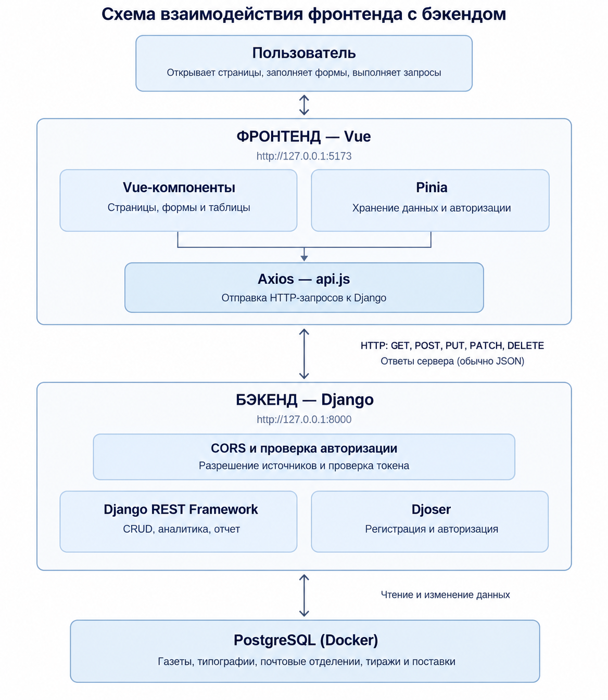

## Скриншоты интерфейсов

Регистрация:

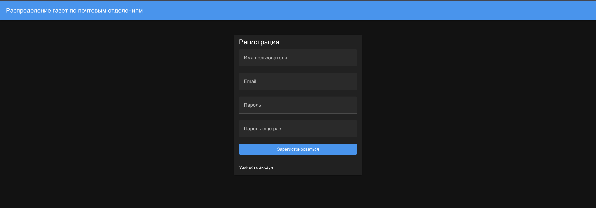

Вход:

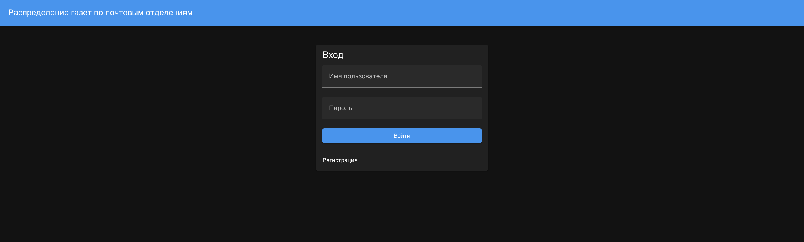

Учётная запись:

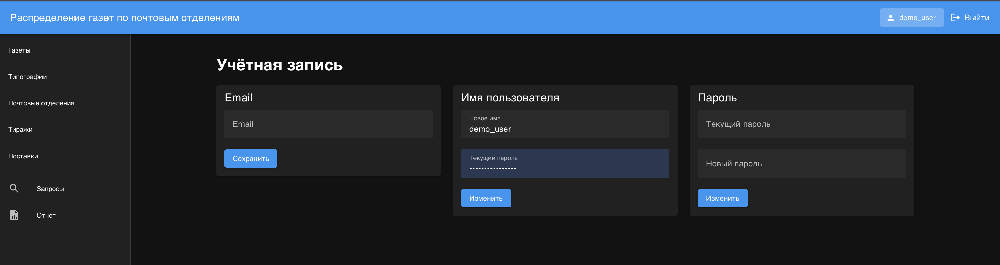

Газеты:

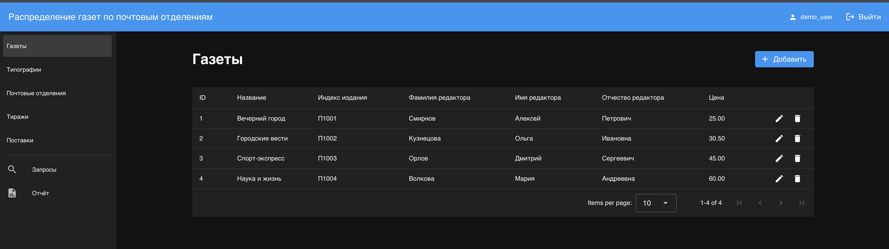

Типографии:

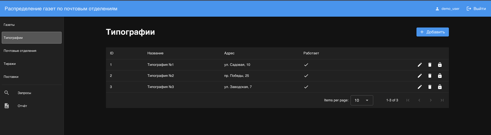

Почтовые отделения:

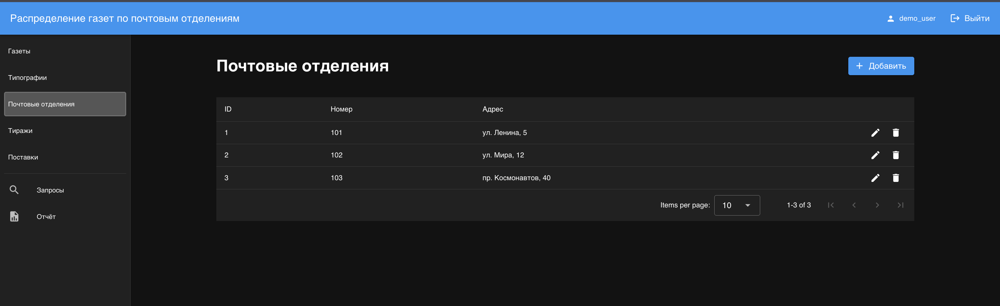

Тиражи:

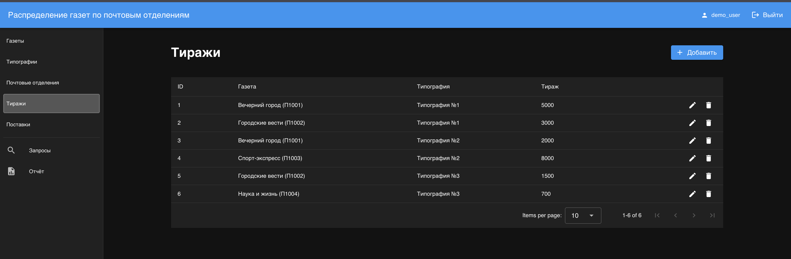

Поставки:

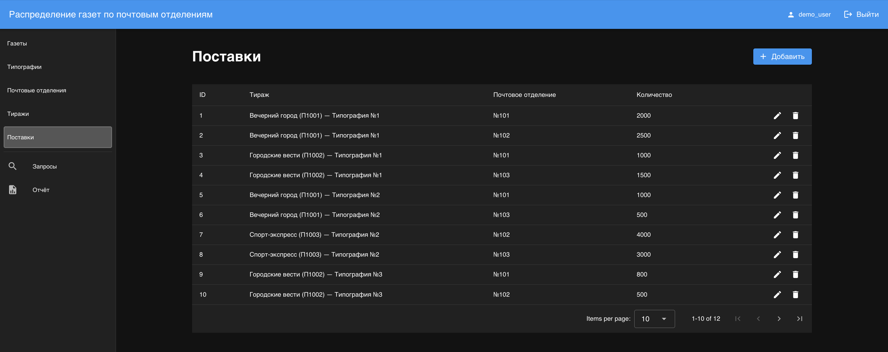

Создание тиража:

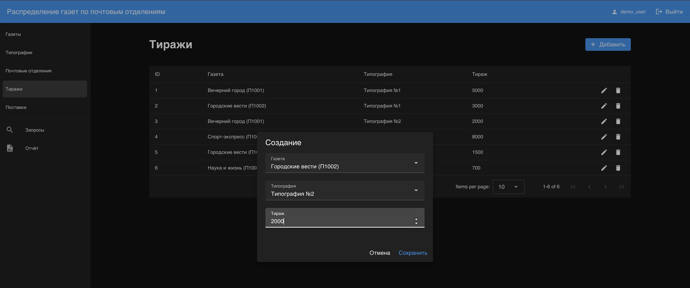

Изменение записи:

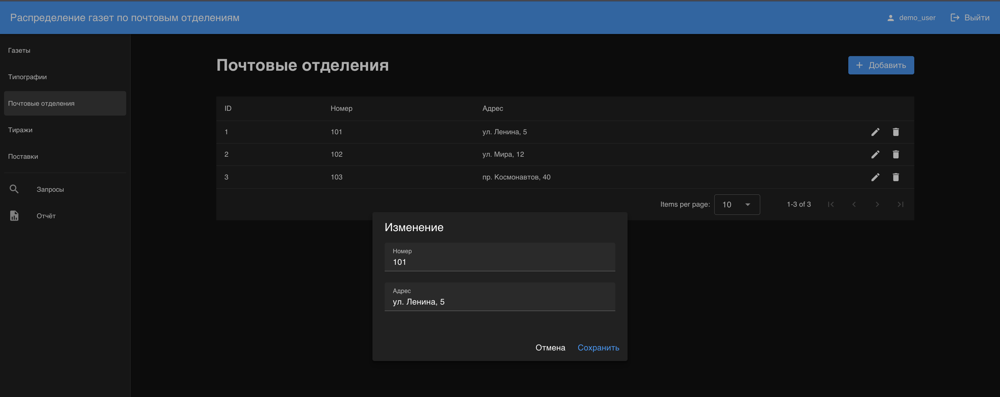

Ошибка валидации:

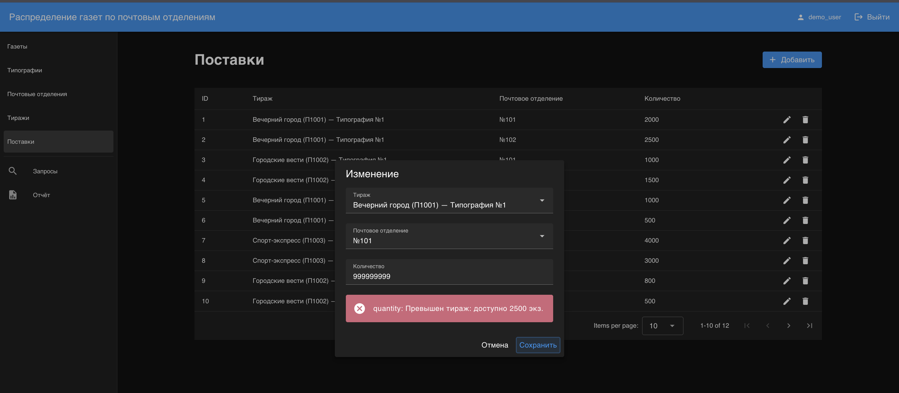

Аналитика 1:

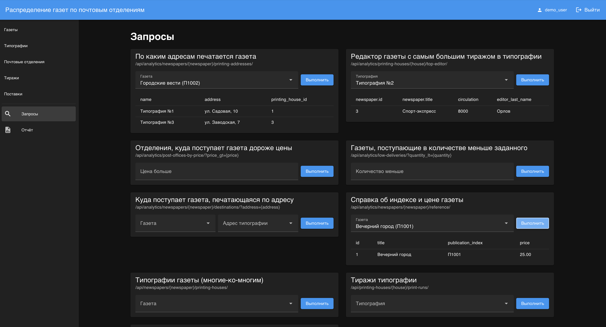

Аналитика 2:

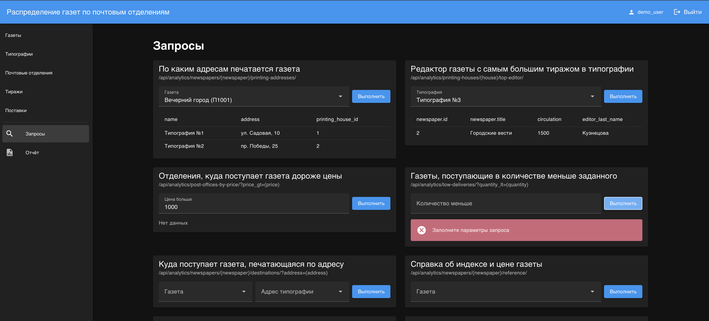

Отчёт:

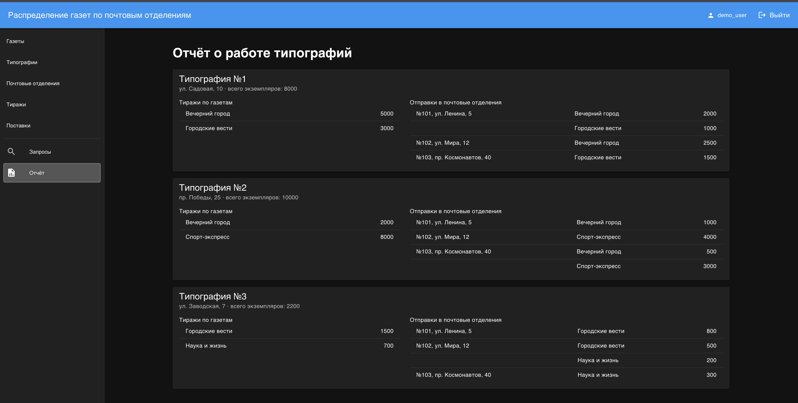

## Вывод

В ходе лабораторной работы была разработана клиентская часть веб-приложения с использованием Vue 3 и Vuetify. В приложении реализованы регистрация, вход и выход из учётной записи, изменение данных пользователя, а также просмотр, добавление, редактирование и удаление записей пяти сущностей. Кроме того, предусмотрена возможность выполнения аналитических запросов и просмотра отчёта.

Для взаимодействия с серверной частью настроена работа с REST API, а для авторизации пользователей используются токены Djoser. Также на сервере настроен CORS, обеспечивающий взаимодействие с фронтендом.

В результате было создано веб-приложение, которое позволяет пользователю работать с данными о распределении газет по почтовым отделениям через удобный интерфейс.